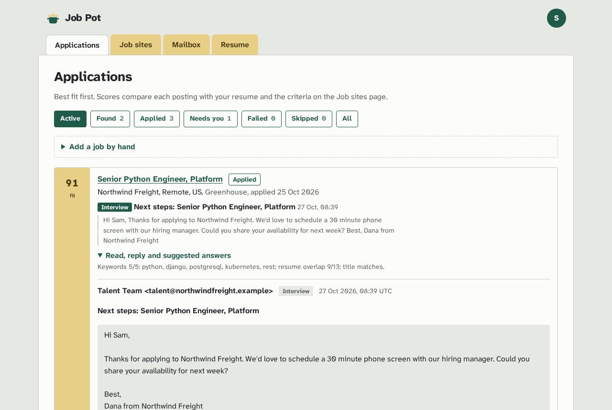
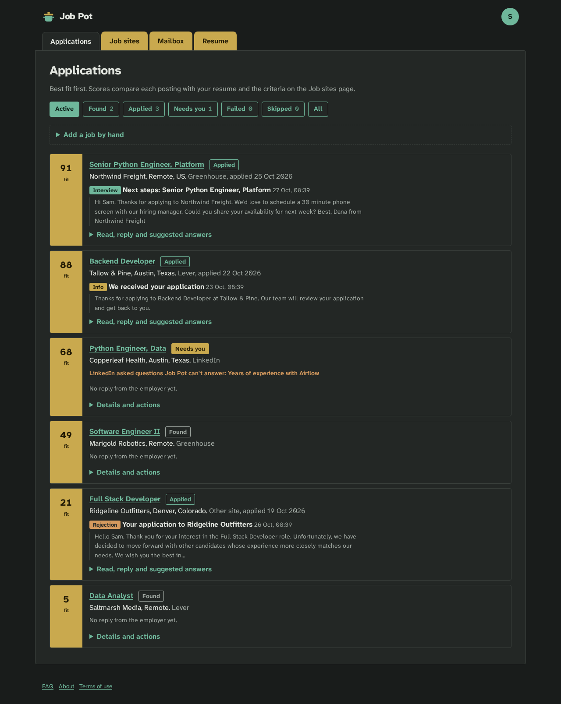
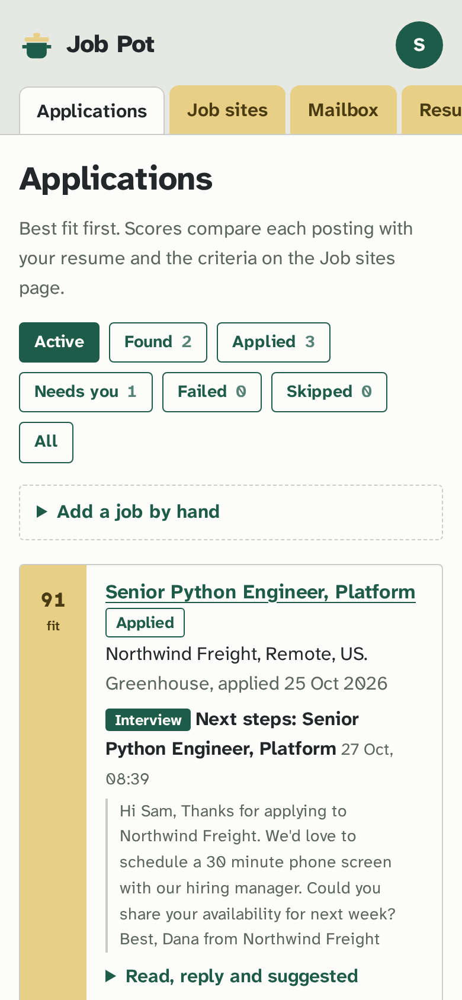

# Job Pot

A self-hosted job search assistant. Upload your resume, say what kind of job you want, and connect the job sites you use. Job Pot searches them around the clock, scores every posting against your resume, applies for you where it can, and reads a dedicated mailbox so employer replies show up under the right application, with suggested answers.

It runs on your own server in Docker, keeps everything in one database there, supports several separate accounts, and can use a local AI model through [Ollama](https://ollama.com). No resume text or email goes to a third-party AI service.



| Dark mode | Phone |
|---|---|
|  |  |

## What it does

| Page | What you can do there |
|---|---|
| **Applications** (home) | Every job found or applied to, **best fit first**. Each one shows its fit score, the site, its status, and whether the employer replied, with an excerpt of the reply. Open it to read the full email, send one of the suggested replies (editable), or write your own. Filter by status, add a job by hand, change a status, or ask the AI to explain the fit. |
| **Job sites** | One page for all sites and for your criteria: wanted titles, keywords, words to avoid, locations, remote only, lowest pay, the minimum fit score for applying automatically, and a daily limit. Turn each site on, enter its sign-in where needed, choose whether Job Pot may apply for you, or press *Search now*. |
| **Mailbox** | One page to connect the email address Job Pot reads and replies from (IMAP and SMTP), with settings for common providers, *Test connection*, *Check mail now*, and replies that couldn't be matched to an application (attach them by hand). |
| **Resume** | Upload a PDF, Word or text resume. Job Pot pulls out the text, checks it (contact details, length, bullet points, numbers in achievements, weak phrases, first-person words, section headings, long paragraphs, and keywords from your criteria that are missing), and lists fixes. Edit the text in place; the AI model can do a full review. |
| **User menu** (top right) | Profile, Settings, Administration (admin only), FAQ, About, Terms of use, theme (system, light, dark) and sign out. |
| **Profile** | Name, email, phone, location and links used in applications. **Change the username you sign in with.** |
| **Settings** | Turn automation on or off, pick a theme, change your password, and **set up two-step sign-in with an authenticator app** (TOTP, with QR code). |
| **Administration** | Create accounts with a temporary password, reset passwords and two-step sign-in, delete accounts with all their data, and configure the local AI model. |

### Job sites

| Site | Finds jobs | Applies for you | Notes |
|---|---|---|---|
| **LinkedIn** | Yes, Easy Apply jobs, through LinkedIn's public job search | Yes, Easy Apply, in a headless browser signed in with your account | LinkedIn's user agreement forbids automated tools and can restrict accounts. Off until you tick an acknowledgement. **The applying part has not been tested against a real LinkedIn account yet.** |
| **Greenhouse** | Yes, from company job boards you list (public API) | Yes, fills the employer's form | Fills name, email, phone, location, LinkedIn and resume. If the form asks anything else or shows a captcha, the job is marked *Needs you*. Most real forms have extra questions. |
| **Lever** | Yes, from companies you list (public API) | Yes, same approach as Greenhouse | Same as Greenhouse. |
| **Ashby** | Yes, from companies you list (public API) | Yes, same approach as Greenhouse | Fills name, email, phone, LinkedIn, GitHub, website and resume. Dry-run tested on real forms; a real submit has not been tried yet. |
| **SmartRecruiters** | Yes, from companies you list (public API) | No | Its application form runs over several steps Job Pot can't fill yet. Open the job to apply. Reads at most 60 full postings per company each run. |
| **ZipRecruiter**, **Indeed**, **Monster** | No | No | These sites block automated visitors (tested: Cloudflare or captcha pages, even for a real browser). Add their jobs by hand to score them and track replies. |
| **Any other site** | Add by hand | No | Paste the title, company, link and description. |

Job Pot never retries a job that might already have been sent: if it presses submit and can't see a confirmation, the job is marked *Needs you* so you can check.

### How the fit score works

Out of 100: up to **60** for how many of your keywords the posting mentions, up to **30** for how much of the posting's main vocabulary also appears in your resume, and **10** if the title matches one you want. Postings mentioning a word you excluded are dropped. Postings outside your locations, not remote when you asked for remote, or paying less than your minimum (when pay is listed) are kept as *Skipped* with the reason. With AI on, *Ask AI about the fit* can move a score by up to 15 points and adds a one-line reason.

### The background worker

When automation is on for an account, the worker runs every 15 minutes. For each enabled site it searches and scores new postings. It then applies to the best *Found* jobs that meet your minimum fit, up to your daily limit, on sites where you allowed automatic applying, pausing 20 to 60 seconds between applications. Last, it checks your mailbox, matches replies to applications, sorts them (interview, offer, rejection, info, other), and drafts suggested replies.

## Install with Docker

You need Docker with the Compose plugin.

```sh
git clone https://github.com/SuttonComputerServices/Job-Pot.git
cd Job-Pot
cp .env.example .env          # optional: edit settings
docker compose up -d --build
```

Open `http://localhost:8000` on the same machine.

By default Job Pot only listens on the machine it runs on, because sign-in and saved passwords must not cross the network unencrypted. To use it from other devices (your phone, another computer), either put it behind an HTTPS reverse proxy (see [HTTPS](#https)), or, on a home network you trust, set `JOBPOT_BIND=0.0.0.0` in `.env` and open `http://your-server:8000`.

### First sign-in

There is **no default admin password**. On the first visit:

1. Get the one-time setup token from the server log:
   ```sh
   docker compose logs web | grep "Setup token"
   ```
2. Sign in as **admin** with an empty password. Job Pot asks for the setup token and a new password (12 characters or more).
3. Turn on two-step sign-in in **Settings**, then create accounts for other people in **Administration**.

The token stops anyone who reaches a fresh install before you from claiming it. It is deleted once the password is set.

### Optional: local AI with Ollama

```sh
echo "OLLAMA_URL=http://ollama:11434" >> .env
docker compose --profile ai up -d
docker compose exec ollama ollama pull llama3.1:8b
```

Then open **Administration → Local AI**, tick *Use the local AI model*, and press *Test connection*. An Ollama server elsewhere on your network works too: enter its address there. With AI off or unreachable, every feature falls back to built-in rules.

AI is used for: explaining fit scores, a full resume review, sorting employer emails, and drafting one extra reply suggestion.

### Settings (`.env`)

| Variable | Default | Meaning |
|---|---|---|
| `JOBPOT_SECRET_KEY` | generated | Master key for encrypting saved passwords (32+ characters). If empty, one is created in the data volume as `secret.key`. |
| `JOBPOT_BIND` | `127.0.0.1` | Host address to publish on. `0.0.0.0` exposes plain HTTP to your network. |
| `JOBPOT_PORT` | `8000` | Port on the host. |
| `JOBPOT_ALLOW_PRIVATE_MAIL_HOSTS` | `0` | Set to `1` if a mailbox lives on a server inside your own network. Otherwise mail servers must have public addresses, so users can't make Job Pot connect to internal machines. |
| `JOBPOT_HTTPS` | `0` | Set to `1` when served over HTTPS, so the session cookie is HTTPS-only. |
| `JOBPOT_WORKER_INTERVAL` | `900` | Seconds between background runs. |
| `OLLAMA_URL` | empty | Default Ollama address (the admin can change it in the app). |
| `OLLAMA_MODEL` | `llama3.1:8b` | Default model name. |
| `JOBPOT_HEADLESS` | `1` | Set to `0` to watch the browser while debugging (needs a display). |

### HTTPS

Put Job Pot behind a reverse proxy that handles certificates, for example Caddy:

```
jobs.example.com {
    reverse_proxy 127.0.0.1:8000
}
```

and set `JOBPOT_HTTPS=1`. With the default `JOBPOT_BIND=127.0.0.1`, the plain-HTTP port is only reachable by a proxy on the same machine. If the proxy runs elsewhere, bind to an address only it can reach.

### Backups

Everything lives in the `jobpot-data` volume: the database `jobpot.db` and `secret.key`. **Back up both together.** Without the key, saved site and mailbox passwords can't be decrypted (everything else still works; users re-enter those passwords).

```sh
docker compose exec web python -c "import sqlite3; sqlite3.connect('/data/jobpot.db').backup(sqlite3.connect('/data/backup.db'))"
docker compose cp web:/data/backup.db ./jobpot-backup.db
docker compose cp web:/data/secret.key ./jobpot-secret.key
```

### Updating

```sh
git pull
docker compose up -d --build
```

The database tables are created automatically; there are no migrations yet (see *Limitations*).

## Using it

1. **Profile**: fill in your name, email, phone, location and links. These go into applications.
2. **Resume**: upload your resume and fix what the suggestions point out. Scanned PDFs have no text, so paste the text instead.
3. **Job sites**: set your criteria, then turn on the sites you want. For Greenhouse, Lever, Ashby and SmartRecruiters, list company names (the part after `boards.greenhouse.io/`, `jobs.lever.co/`, `jobs.ashbyhq.com/` or `jobs.smartrecruiters.com/`). For LinkedIn, enter a search location and your sign-in.
4. Press **Search now** on a site to see results right away on **Applications**.
5. **Mailbox**: connect a separate address used only for job hunting. Gmail and Fastmail need an app password.
6. **Settings → Automation**: turn it on to search, apply and check mail every 15 minutes.

## Security

- **No default credentials.** The admin password is set on first sign-in, protected by a one-time token printed only to the server log.
- **Passwords** are hashed with Argon2id. Sign-in locks for five minutes after five wrong attempts for a username from the same address, so a stranger can't lock you out. Changing a password signs out your other sessions.
- **Two-step sign-in** with any TOTP authenticator app; a code can't be used twice.
- **Saved site and mailbox passwords and two-step secrets are encrypted** with a key unique to each account (HKDF from the master key, Fernet). A copied row can't be decrypted with another account's key.
- **Accounts are separate.** Every record belongs to one account and is looked up through a single ownership check, so another account's records look like they don't exist (404).
- **Every form is CSRF-protected**, cookies are `SameSite=Lax` (and `Secure` with `JOBPOT_HTTPS=1`), and pages send a strict Content Security Policy (no inline scripts or styles, no third-party resources), `X-Frame-Options: DENY` and `nosniff`.
- The AI server address is an admin-only setting, and mailbox servers must be public addresses (unless the admin allows private ones), so users can't point the server at internal machines.
- A saved mailbox password is only sent to the servers it was entered for. Changing the server, address or login means typing the password again.
- Plain HTTP is only published on localhost by default.
- The containers run as a non-root user.

The code was audited with Claude Code's `security-review` skill and the `claude-security` plugin before release; see [`docs/security-audit.md`](docs/security-audit.md).

## Development

```sh
uv venv --python 3.12 .venv            # or: python3.12 -m venv .venv
uv pip install --python .venv -e ".[test]"
.venv/bin/playwright install chromium   # only for applying and the browser test
.venv/bin/pytest -q
```

Run it locally:

```sh
.venv/bin/uvicorn jobpot.web.app:app --reload        # web UI on :8000, data in ./data
.venv/bin/python -m jobpot.worker                    # background worker
```

### Layout

```
jobpot/
  config.py db.py models.py   settings, SQLAlchemy engine, tables
  crypto.py security.py       per-account encryption, passwords, setup token, lockout
  matching.py                 fit score and filters
  resume.py mail.py ai.py     resume checks, mailbox, Ollama client
  worker.py                   the 24/7 loop
  connectors/                 one module per job site behind connectors/base.py
  web/                        FastAPI routes (auth, account, jobs, resume, mailbox)
  templates/ static/          Jinja2 pages and the stylesheet
tests/                        pytest suite (network calls are faked; fixtures are saved real responses)
docs/specs, docs/plans        design spec and implementation plan
```

A new job site is a `Connector` subclass in `jobpot/connectors/` with `discover()` and optionally `apply()`, added to `connectors/registry.py`. The Job sites page and the worker pick it up from there.

## Limitations

- **LinkedIn applying is untested** against a real account. LinkedIn changes its pages often and may ask for security checks; when it does, jobs are marked *Needs you*.
- **Custom application questions aren't answered.** Greenhouse, Lever and Ashby forms with extra questions stop at *Needs you*.
- **ZipRecruiter, Indeed and Monster** can only be tracked by hand.
- **Mail** uses IMAP and SMTP with a password. Accounts that only allow OAuth sign-in (some Microsoft accounts) won't connect.
- **No database migrations yet.** Adding columns in a future version will need a migration tool (such as Alembic).
- The sign-in lockout is kept in memory, so it resets when the web container restarts.
- Tested on Linux with Docker 29 and Python 3.12.

## Licence

MIT — see [LICENSE](LICENSE). The bundled typeface, Atkinson Hyperlegible Next, is used under the SIL Open Font License (`jobpot/static/OFL-atkinson.txt`).
